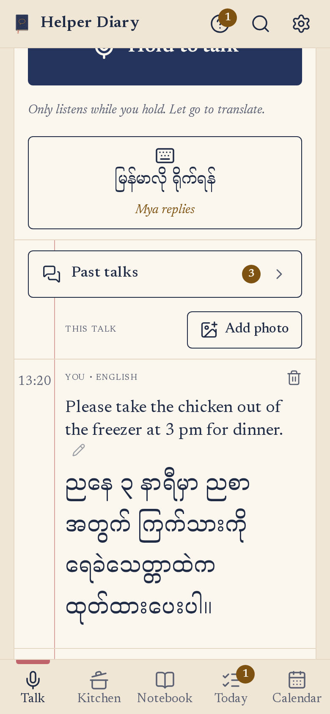
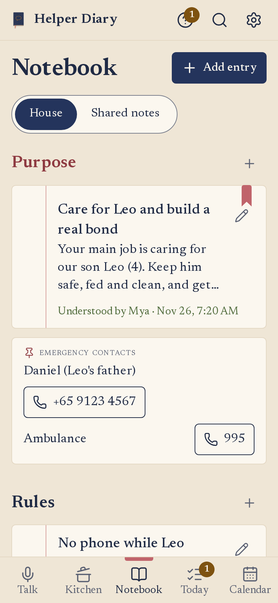
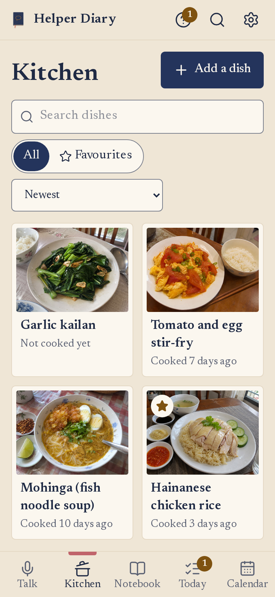
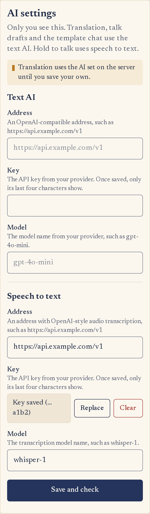

# Helper Diary

**A shared notebook for a family and their domestic helper, with translation built in.**

Many families live with a helper who speaks another language. Instructions get mimed or typed into a translation app,
and nothing said is kept. Helper Diary fixes that. On one phone, the employer speaks or types in English or 中文 and the
helper reads it in her own language: Burmese, Bahasa Indonesia or Tagalog. She types her answer back in her language.
Every talk is saved, and the app drafts what was agreed into her Notebook, her tasks for Today and the household
calendar, in her language, after the employer checks it.

It is for the family (one or two employers) and their helper, each on their own phone browser.

https://github.com/user-attachments/assets/fe4b1433-d77b-4e18-8cf4-8d9dcba6ff0c

*A four-minute walkthrough with the demo household: the owner signs in, invites his wife and their helper,
and each of them uses the app in their own language. The same file is in the repo at
[`docs/video/helper-diary.mp4`](docs/video/helper-diary.mp4), with subtitles in [`docs/video/helper-diary.srt`](docs/video/helper-diary.srt).*

| Talk | Today (the helper, in Burmese) | Notebook | Kitchen | AI settings |
| --- | --- | --- | --- | --- |
|  |  |  |  |  |

*Screenshots from the demo household that `pnpm seed:review` creates (Daniel, Mei and their helper Mya).*

## Why I made this

We hired a new helper who knew only a few words of English. On her first day, my wife gave her the usual first-day
brief: the house rules, the daily routine, what our son eats. She did it all in Talk, just speaking to her normally.
The app caught everything she said, and the AI then picked out the key points and drafted them into the helper's
Notebook. Nobody had to sit down afterwards and write notes. It was the first time a tool like this felt seamless to us.

Kitchen turned out to be handy for the small things that are hard to explain. Our son likes his breakfast bread with
Nutella, with the bread cut into a circle. That is now a photo and a line in the dish book, so she can look it up
instead of guessing, and the same goes for the other food he likes.

So this app is for one moment: a family has just hired a helper who is new and doesn't speak much English yet. It helps
you both get through the first weeks while she learns the house. Once she knows the routine and you understand each
other, you probably won't need it any more. That is the point.

The part I like best is what happens when that moment comes round again. The Notebook, the tasks and calendar, and the
Kitchen belong to the household, not to one helper. When a new helper joins, she starts with all of it on day one, and
you don't have to give the same brief from scratch. If she speaks a different language, the app translates everything
already saved into hers once, in the background. Two things stay behind: the old talks, which a new helper never sees,
and the last helper's private notes.

## Before you use it

I built this in a few days, mainly for my own household. I'm sharing it because someone in the same spot might find it
useful. A few things to know:

- **Burmese, Bahasa Indonesia and Tagalog may not sound native.** The translations come from whichever AI model you set
  up, and the app's own buttons and labels in these languages were not written by a native speaker. Some lines may read
  stiff or a bit odd. If you or your helper speak one of them, fix the labels in your copy: they are in
  `lib/strings/*.ts`, one file per screen.
- **It fits how my family works.** One household per copy, one or two employers, one helper. If yours is different,
  fork it and change it (see [Adapting it to your stack](#adapting-it-to-your-stack)).
- **No support promised.** I use it at home and fix what bothers me. Issues and forks are welcome, but treat it as a
  starting point, not a finished product.

## What it does

- **Talk.** Type, use your keyboard's mic key, or hold a button to speak. The helper sees the translation in large text
  and replies in her own language. After you let go of the button, the AI reads what you said against the talk so far
  and fixes words that were clearly misheard ("chicken nice" becomes "chicken rice" when you're talking about food).
  If your English (or 中文) is broken, that's fine: the translation goes by what you mean, so it still reads clearly in
  her language, and your own line stays as you said it. One talk per day; every line can be corrected or deleted.
- **Notebook.** Each talk is drafted into key points, instructions and guides. The employer approves, edits or drops
  each one before the helper sees it (safety points such as allergies save themselves, marked "auto-added").
- **Today and Calendar.** Her tasks and routines, ticked off as she goes; family events and days off; ready-made
  task templates, and an AI chat that writes a routine for your home.
- **Questions and My notes.** She asks about any entry or task; you answer in your language. Her own notes stay
  private until she shares them.
- **Kitchen.** A shared dish book: a photo and a name, an optional recipe, "Cooked today".
- **Five languages.** English, 中文, Burmese, Bahasa Indonesia and Tagalog. Each person picks theirs, and text is
  translated only into the languages your household uses.
- **Privacy.** A new helper does not see talks from before she joined. Saved AI keys never leave the server.

## How you use it

Helper Diary is a web app you **deploy yourself** and then open in the phone's browser (add it to the home screen if
you like). A deployed copy is needed because the employer's phone and the helper's phone share their data through it:
what you approve on yours shows up on hers.

**One copy serves one household.** The owner's account comes from the server's settings, and everyone else joins with
an invite code the owner makes. Each family deploys its own copy, on its own AI key.

## Set it up

There are two ways to run it: with Node.js directly, or in Docker. Docker needs nothing else installed and keeps
the data in one volume; the steps below show both where they differ.

### 1. Install

You need **Node.js 24 or newer** (the app uses Node's built-in SQLite) and **pnpm 10 or newer**.

```sh
git clone <your fork or copy of this repository> helper-diary
cd helper-diary
pnpm install
pnpm build && pnpm release
```

`pnpm release` writes a self-contained server to `release/server` (and a static copy to `release/site`).

With Docker instead, you need only Docker. Clone the repository and build the image; it runs the same two build
steps inside:

```sh
git clone <your fork or copy of this repository> helper-diary
cd helper-diary
docker build -t helper-diary .
```

### 2. Settings

Copy the example file and fill it in. Every setting the server reads is in it:

```sh
cp .env.example .env
```

| Setting | What it does |
| --- | --- |
| `APP_ADMIN_EMAIL` | The household owner's sign-in email. The owner account is created on first start. |
| `APP_ADMIN_PASSWORD` | The owner's password. Use a long unique one; only its hash is stored. |
| `DATA_DIR` | Absolute path of the folder for the database and photos. It must last across restarts and redeploys, outside `release/`. |
| `AI_BASE_URL` | Optional. An OpenAI-compatible chat address used until the owner saves their own in Settings. |
| `AI_API_KEY` | Optional. The key for `AI_BASE_URL`. Read on the server only. |
| `AI_MODEL` | Optional. The chat model at `AI_BASE_URL`. |
| `HOUSEHOLD_TZ` | Your time zone (IANA name, e.g. `Asia/Singapore`, the default). Decides what "today" is. |
| `PORT` | Port to listen on. Default `8080`. |
| `HOST` | Address to bind. Default `0.0.0.0`. |

Until both `APP_ADMIN_EMAIL` and `APP_ADMIN_PASSWORD` are set and the owner account exists, sign-in and sign-up stay
closed. The owner account is created only once; changing the variables later does not change an existing account.

### 3. Run it

```sh
node --env-file=.env release/server/server.mjs
```

With Docker (the image ignores `DATA_DIR` and keeps the data in the `/data` volume):

```sh
docker run -d --name helper-diary --restart unless-stopped -p 8080:8080 \
  -v helper-diary-data:/data --env-file .env helper-diary
```

Open `http://localhost:8080` (or your server's address) and sign in with the owner's email and password.
For a real household, put it behind HTTPS: the session cookie is `Secure`, and phone browsers only allow the
microphone on HTTPS.

### 4. Invite your helper (and the other employer)

In **Settings**, under **Invite someone**, pick **Helper** or **Employer (family)** and tap **Make an invite**. Send her the link or the code. She opens
it on her phone, picks her language (Burmese, Bahasa Indonesia, Tagalog, English or 中文), chooses a sign-in name and
password, and lands on Today. Codes are single-use, and you can revoke one that is not used yet. Everyone can change
their own password later under **Settings › Account**.

**If someone forgets their password.** In **Settings › Household**, tap **Reset password** beside their name and send
them the code or link. It works once, within 24 hours; they choose a new password and are signed in. If the owner
forgets theirs, set a new one on the server, in the folder the app runs from:

```sh
DATA_DIR=<your data folder> node reset-owner-password.mjs
```

In Docker: `docker exec -it helper-diary env DATA_DIR=/data node reset-owner-password.mjs`.

### 5. Enter the AI and speech settings

Translation, talk drafts and the template chat need a text AI; Hold to talk needs speech to text. As the owner, open
**Settings › AI settings** (only the owner sees this section):

- **Text AI**: the address of any OpenAI-compatible chat API (for example `https://api.openai.com/v1`, or another
  provider's compatible endpoint such as DeepSeek's), your key, and a model name.
- **Speech to text**: an address with OpenAI-style audio transcription (`/audio/transcriptions`), a key and a
  transcription model (for example `whisper-1`). It can be the same provider or a different one. For DeepSeek's speech
  to text, enter its full address `https://api.deepseek.com/v1/tools/asr`; it takes no model or language, so any model
  name will do.

**Save and check** stores them and makes one small call to tell you whether they work (address unreachable, key refused,
model not found). A saved key shows only as its last four characters. Hold to talk appears on Talk once speech to text
is filled in; the text box always works. If the server has `AI_*` settings, text AI uses them until you save your own.
Without any text AI, everything still saves, just untranslated.

Saved keys are stored in the database under `DATA_DIR`, so protect that folder like the keys themselves.

**What I use.** My own copy runs on DeepSeek for both parts: its chat API (`https://api.deepseek.com/v1`) for text AI,
and its speech to text (`https://api.deepseek.com/v1/tools/asr`) for Hold to talk. One key covers both. It costs very
little and answers fast, which matters on Talk, where every line waits for its translation. For what this app asks
of it (translating short lines, picking key points out of a talk, writing a routine), it has been more than enough for
our household. Only the employers use Hold to talk, so speech to text needs to handle English and 中文 only; the helper
types her replies. If you prefer another provider, any OpenAI-compatible one works: put its address, key and model in
Settings instead.

### Try it with demo data

```sh
pnpm review
```

starts the built app on a temporary folder filled with the demo household and prints its address. Sign in as
`admin@example.test` / `review-password-123` (the owner), `mei` / `mei-review-123` (the other employer, 中文) or
`mya` / `mya-review-123` (the helper, Burmese). Never use these on a real copy.

## Hosting

**On a server with a lasting disk, it runs as is.** Any VPS, home server or container platform that gives you a
persistent volume works: build, run `release/server/server.mjs` with the settings above, point `DATA_DIR` at the volume,
and put HTTPS in front (Caddy, nginx, or your platform's proxy). Keep backups of `DATA_DIR`.

Three things keep a home copy safe:

- **Use a long, unique owner password.** Sign-in allows 8 tries per account every 15 minutes, which stops guessing
  only if the password is not guessable.
- **Let your proxy set `X-Forwarded-For`.** The app limits sign-in tries per caller and reads the caller's address
  from the last entry of that header. Caddy and Traefik add it by default; with nginx, add
  `proxy_set_header X-Forwarded-For $proxy_add_x_forwarded_for;`.
- **Keep `DATA_DIR` private.** The database holds everything the household wrote and the saved AI keys, unencrypted.
  Make the folder readable only by the user the app runs as (`chmod 700`), and keep it out of the web root.

**With Docker.** The image (steps 1 and 3) runs the app as a non-root user with the database and photos in the
`helper-diary-data` volume, so back up that volume. To update: `git pull`, `docker build -t helper-diary .`, then
`docker rm -f helper-diary` and the same `docker run` as before; the volume keeps the data. The owner's password reset is under "If someone forgets their password" above.

**Vercel (and other serverless hosts) need changes.** They have no lasting disk, so the SQLite database and the photo
files under `DATA_DIR` would be lost. To host there, move the data to a hosted database and the photos to object
storage.

## Adapting it to your stack

Anything beyond the plain set-up above, such as hosting on Vercel, another database, another sign-in, or many households
on one copy, means changing the code. The easiest way is to open this repository in **Claude Code or another AI coding
agent** and ask it to make the change for your stack. Point it at `AGENTS.md` and `docs/architecture.md` first; they
describe how the app is put together. Some tips:

- **Hosting on Vercel:** ask the agent to replace the SQLite file in `lib/server/db.ts` and the photo files in
  `lib/server/photos.ts` with hosted services, and to drop the `release` packaging in favour of Vercel's own build.
- **Database and photos on Supabase:** Supabase gives you Postgres for the data and Storage for the photos, which
  together replace everything under `DATA_DIR`.
- **Another sign-in:** Clerk or Supabase Auth can replace the built-in email-and-password accounts in
  `lib/server/auth.ts`. Keep the rule that the server checks every request against the signed-in user.
- **Many households on one copy:** today one copy is one household. Ask the agent to add a household to every table and
  to every check in `lib/server/api.ts`, and to replace the owner-from-settings start-up with a sign-up that creates a
  household. Pair it with Clerk or Supabase Auth.

## For developers

- Stack: Next.js (App Router), TypeScript, Tailwind CSS, SQLite via `node:sqlite`, the Vercel AI SDK against any
  OpenAI-compatible API.
- Checks: `pnpm typecheck`, `pnpm lint`, `pnpm test` (server tests). Development server: `pnpm dev`.
- `pnpm audit --prod` still lists undici 5 (and @fastify/busboy). The AI SDK pulls it in for a URL-download helper the
  app never calls, and the release package does not contain it.
- How it is built: `AGENTS.md`, `docs/architecture.md`, `docs/testing.md`.

## Licence

Apache License 2.0. Copyright the Helper Diary authors. See [LICENSE](LICENSE) and [NOTICE](NOTICE).
